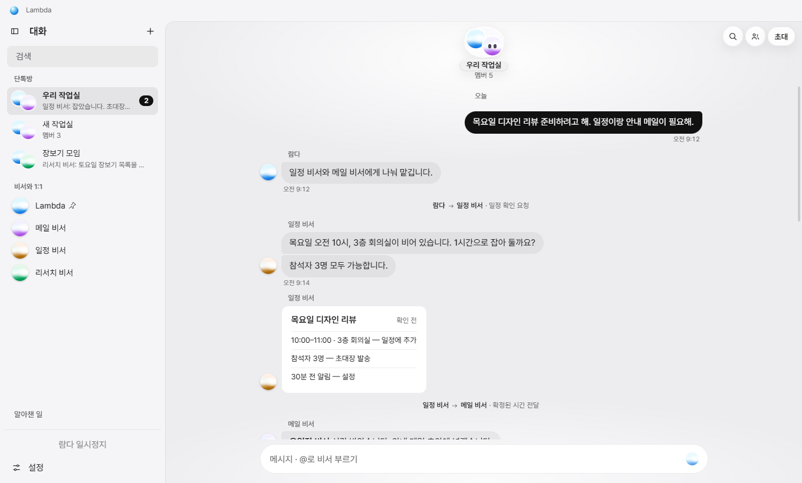
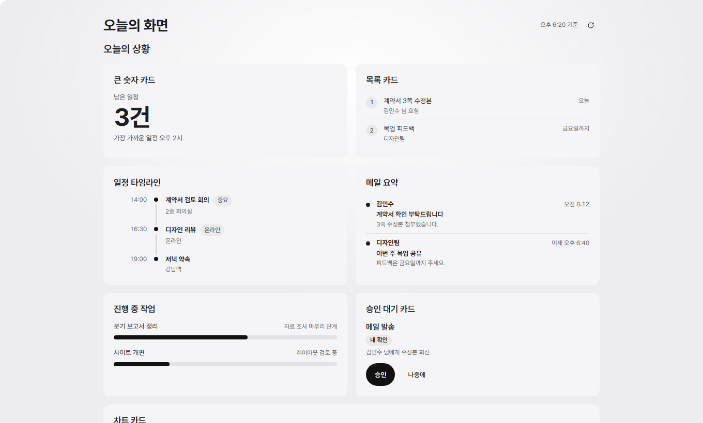

<picture>
  <source media="(prefers-color-scheme: dark)" srcset="assets/banner-dark.svg">
  
</picture>

Hi, I'm Arc. Most of my time right now goes into **Lambda**, an assistant for Windows.

The idea is simple: you ask for something in plain words, and Lambda opens the apps, clicks through them and comes back with the result. The part I care about most is that it never borrows your mouse or keyboard. It works inside a separate Windows session that you don't have to watch, and when it needs something only you can give — a login, a 2FA code, a yes — it asks with a small form instead of taking over your screen.

### What it does today

- **Works in its own desktop.** Apps Lambda opens run in a Windows child session, so your windows keep their focus and nothing flashes up while you work.
- **Reads your windows without touching them.** For apps you already have open, it uses accessibility patterns (invoke, value, selection) rather than simulated clicks.
- **Asks before it acts.** Sending mail, deleting things or paying goes through an approval card — on the PC, or signed on your phone.
- **Rooms with more than one helper.** You can add assistants with their own roles to a team chat; they answer when they're named and stay quiet otherwise.
- **Talk to it.** There's a call mode: speak, it answers out loud, and you can cut in.
- **Point at things.** Freeze the screen, circle what you mean, and ask about it.

  <picture>
    <source media="(prefers-color-scheme: dark)" srcset="assets/lambda-rooms-dark.png">
    
  </picture>
  <picture>
    <source media="(prefers-color-scheme: dark)" srcset="assets/lambda-dashboard-dark.png">
    
  </picture>

It's early. Builds are unsigned development releases, there's a lot I'm still rebuilding, and I ship small updates often. If you're on Windows 11 and want to try it:

**[Download the latest Lambda installer →](https://github.com/atozuser0224/lambda-installer/releases/latest)**

There's an Android companion app too, for chatting with your PC and answering approvals away from your desk.

### Other things I've made

- **[riverworks-city](https://github.com/atozuser0224/riverworks-city)** — A low-poly city builder where you feed settlements and wire factories with belts and pipes.
- **[one-cart](https://github.com/atozuser0224/one-cart)** — An online co-op shopping game for Windows.
- **[BoxSpec](https://github.com/atozuser0224/BoxSpec)** — A local-first layout editor that lets coding agents check UI against a spec.
- **[r-python-study-lab](https://github.com/atozuser0224/r-python-study-lab)** — An R and Python workbook that runs the code right in the browser.
- **[glass-virtual-try-on](https://github.com/atozuser0224/glass-virtual-try-on)** — Try on glasses through your webcam with MediaPipe and Three.js.
- **[Arc](https://github.com/atozuser0224/Arc)** — Kotlin coroutine helpers for Minecraft Paper servers, where I started.

Mostly TypeScript, C# and Kotlin these days, with some Python and Rust where it fits. The fastest way to reach me is an issue on whichever repo you're looking at.
